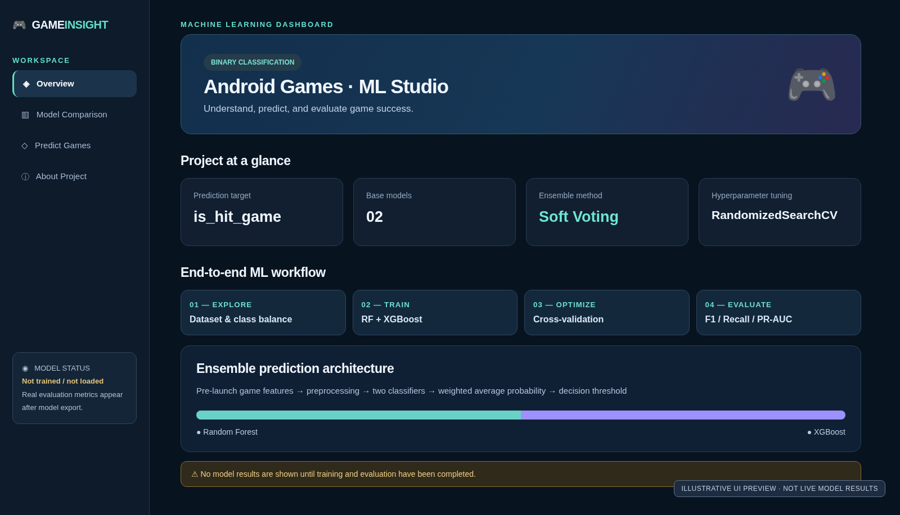
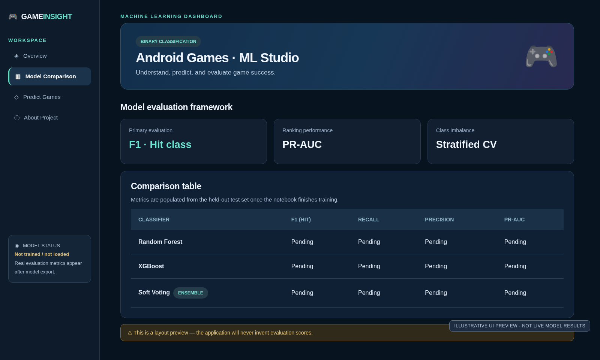
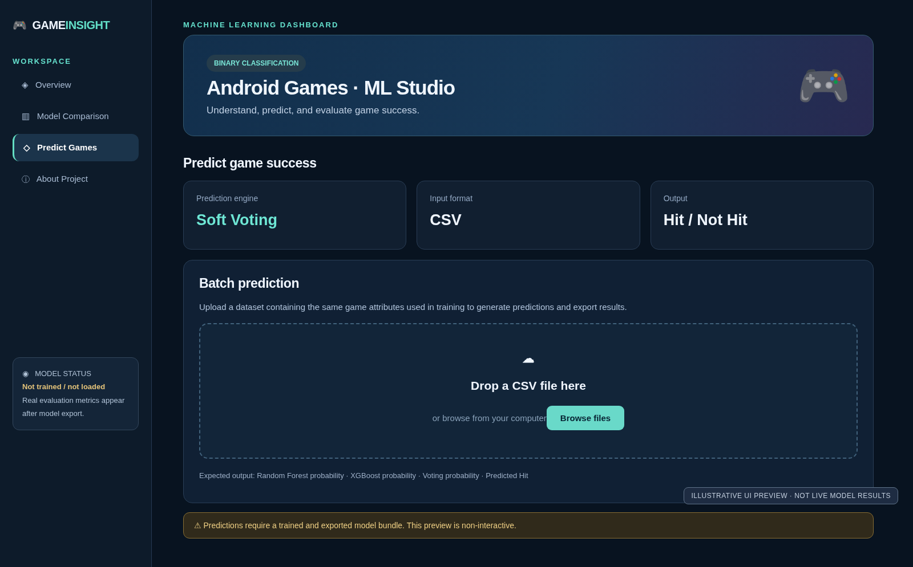

# 🎮 Android Games — Hit Prediction Dashboard

**Exploratory data analysis · Binary classification · Random Forest · XGBoost · Tuned Soft Voting · Streamlit**

This project explores an Android games dataset and predicts `is_hit_game` using Random Forest and XGBoost. A weighted **Soft Voting** ensemble combines both probability estimates. Hyperparameters are tuned with `RandomizedSearchCV`, targeting **average precision (PR-AUC)** for a highly imbalanced dataset. The decision threshold and voting weights are selected on out-of-fold training predictions, not the held-out test data.

> **Important:** The notebook's source describes the data as synthetic. Classification results on synthetic data do not prove real-world forecasting accuracy. Exclude outcome/post-launch columns and verify that the target definition does not leak through any features.

## Streamlit interface previews

The images below are **illustrative UI previews**, not screenshots of a trained, running Streamlit app. No performance scores are represented as real measurements.





## What is included?

- Exploratory data analysis (EDA) in the Jupyter notebook.
- Training pipelines with imputation and one-hot encoding.
- Random Forest and XGBoost, both tuned with `RandomizedSearchCV`.
- Weighted soft voting and decision-threshold selection.
- Comparison by Accuracy, Precision (Hit), Recall (Hit), F1 (Hit), PR-AUC and ROC-AUC.
- Streamlit dashboard displaying authentic exported results.
- CSV batch predictions once the trained model bundle exists.

## Quick start

```bash
python -m venv .venv
# Windows: .venv\Scripts\activate
# Linux / macOS: source .venv/bin/activate
pip install -r requirements.txt
streamlit run app.py
```

The UI opens without trained artifacts but displays **no invented metrics**. To enable predictions:

1. Open `android-games-rf-xgboost-soft-voting.ipynb` in Kaggle/Jupyter.
2. Supply the source dataset `android_games_eda_ready.csv` and adjust the notebook dataset path if necessary.
3. Run all training/evaluation cells through section 26.3.
4. Copy `export_models.py` into the notebook working directory and, **in a notebook cell**, execute `%run export_models.py`.
5. Copy the produced `artifacts/model_bundle.joblib` into this project's `artifacts/` directory.
6. Start/restart Streamlit: `streamlit run app.py`.

**Security:** `joblib.load()` can execute arbitrary code. Load only model files you produced and trust; never allow end users to upload serialized model files.

## Evaluation methodology

| Step | Approach |
|---|---|
| Label | `is_hit_game` (0 = Not Hit, 1 = Hit) |
| Holdout | 80/20 stratified split |
| Tuning | 3-fold stratified CV; `RandomizedSearchCV` |
| Tuning objective | Average precision (PR-AUC) |
| Voting | RF/XGBoost weighted probability mean |
| Decision | Select ensemble weight/threshold from out-of-fold predictions |
| Primary metric | F1 for the minority `Hit` class |
| Additional metrics | Recall, Precision, PR-AUC, ROC-AUC, Accuracy |

**Limitations:** Feature availability must reflect the intended prediction time. Model development decisions, feature choices, and parameter search may still lead to optimistic performance estimates; external and temporal validation is recommended. Probability calibration is not guaranteed.

## Repository structure

```text
android_games_streamlit/
├── app.py
├── export_models.py
├── README.md
├── requirements.txt
├── .gitignore
├── artifacts/                 # created after notebook training
└── screenshots/               # illustrative UI previews
    ├── 01-dashboard-preview.png
    ├── 02-model-comparison-preview.png
    └── 03-prediction-preview.png
```

## Dataset

See the notebook for dataset sourcing, schema, data cleaning, missingness, segment analysis, leakage review and final analysis. The CSV is not bundled with this repository.

## Tech stack

Python · Pandas · NumPy · scikit-learn · XGBoost · Plotly · Streamlit · Joblib
